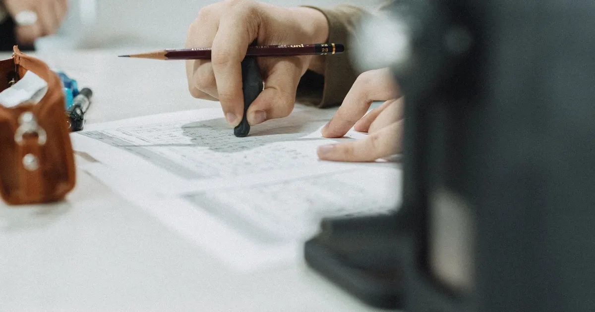
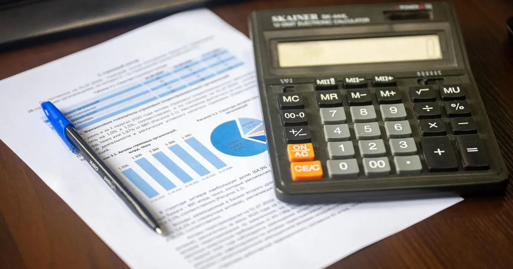

# Draft article cover photographs

Representative Pexels photographs for this draft package, checked on 2026-11-03. These are
editorial illustrations, not official ÖSYM images, actual beneficiaries or endorsements.
Source pages marked the images free under the [Pexels License](https://www.pexels.com/license/).
The licence permits the intended blog use and resizing; photographer/source credits are included.

All 4 covers are 1200 × 630 WebP at quality 80, totalling 168,436 bytes.
Only resize/crop/encoding operations were applied; no generated elements or document retouching.
Objects use new content-addressed keys in the existing development bucket `mentor-public`.
All public objects returned HTTP 200 with matching hashes during image preparation.
The articles were subsequently published locally; see [publication receipt](../publication-local.json)
and [public-read verification](../publication-verification-local.json).
The draft metadata supplies the existing four cover fields; `editorial.coverImageFile` points to the local asset.
Article bodies contain source credits, while the cover is rendered by the existing article header after import.
Do not insert the same cover into the body on import or it will render twice.

[Full source/author/alt/hash/upload manifest](../media-sources.json)

## Açık lise YKS başvuru şartları: Dönem ve kayıt bilgisi

[Mikhail Nilov / Pexels](https://www.pexels.com/photo/woman-in-white-long-sleeves-using-a-laptop-9159651/) · [Article body](../acik-lise-yks-basvuru-sartlari.md)

## YKS eğitim bilgisi güncelleme ve onaylama rehberi

[SHVETS production / Pexels](https://www.pexels.com/photo/a-person-holding-documents-7545311/) · [Article body](../yks-egitim-bilgisi-guncelleme-onaylama.md)

## YKS cevap kâğıdı nasıl doldurulur? Kitapçık kodlama

[Gu Ko / Pexels](https://www.pexels.com/photo/close-up-of-hands-writing-with-pencil-on-paper-32181830/) · [Article body](../yks-cevap-kagidi-kitapcik-kodlama.md)

## Meslek lisesi YKS ek puanı: Koşullar ve örnek hesap

[Bia Limova / Pexels](https://www.pexels.com/photo/office-desk-with-calculator-and-financial-report-33175669/) · [Article body](../meslek-lisesi-yks-ek-puan.md)
