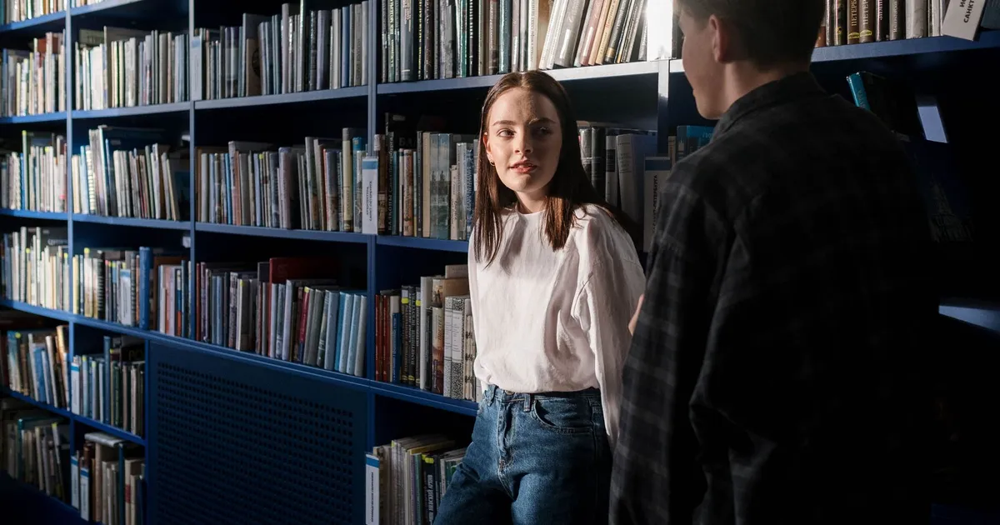
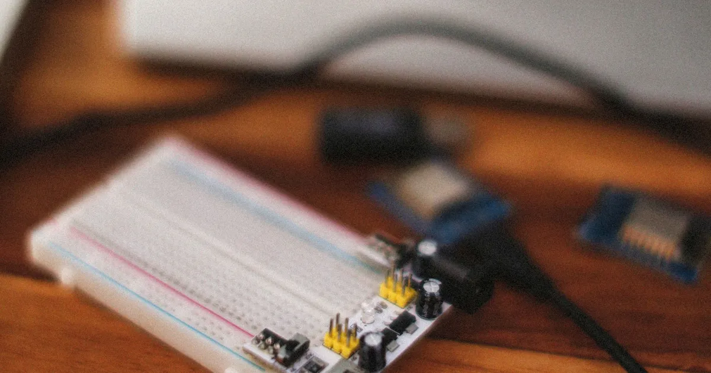
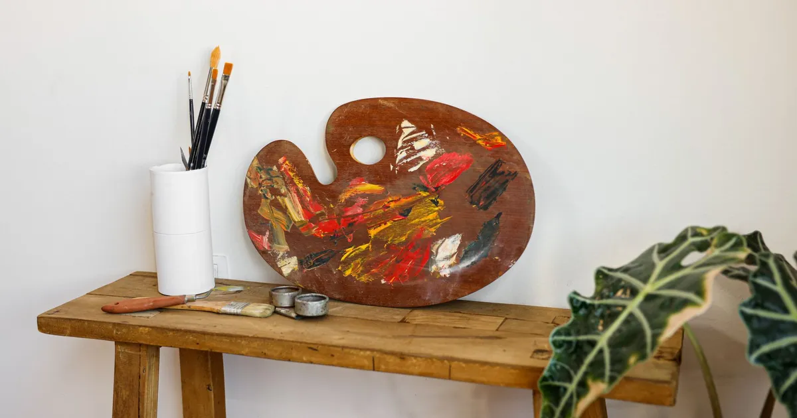

# Draft article cover photographs

Representative Pexels photographs for this draft package, checked on 2026-11-03. These are
editorial illustrations, not official ÖSYM images, actual beneficiaries or endorsements.
Source pages marked the images free under the [Pexels License](https://www.pexels.com/license/).
The licence permits the intended blog use and resizing; photographer/source credits are included.

All 12 covers are 1200 × 630 WebP at quality 80, totalling 817,856 bytes.
Only resize/crop/encoding operations were applied; no generated elements or document retouching.
Objects use new content-addressed keys in the existing development bucket `mentor-public`.
All public objects returned HTTP 200 with matching hashes during image preparation.
The articles were subsequently published locally; see [publication receipt](../publication-local.json)
and [public-read verification](../publication-verification-local.json).
The draft metadata supplies the existing four cover fields; `editorial.coverImageFile` points to the local asset.
Article bodies contain source credits, while the cover is rendered by the existing article header after import.
Do not insert the same cover into the body on import or it will render twice.

[Full source/author/alt/hash/upload manifest](../media-sources.json)

## YKS tercih listesi nasıl hazırlanır? Sıralama ve AİS adımları

[Jakub Zerdzicki / Pexels](https://www.pexels.com/photo/writing-in-notebook-with-checklist-for-task-management-35719566/) · [Article body](../yks-tercih-listesi-nasil-hazirlanir.md)

## YKS tercih kılavuzu nasıl okunur? Tablo 3, Tablo 4 ve taban sıralar

[Nataliya Vaitkevich / Pexels](https://www.pexels.com/photo/magnifying-glass-on-white-paper-6120214/) · [Article body](../yks-tercih-kilavuzu-tablo-okuma.md)

## YKS başarı sırası şartı olan bölümler ve tercih koşulları

[Marchalilah / Pexels](https://www.pexels.com/photo/smiling-young-woman-writing-in-a-notebook-while-sitting-at-the-desk-with-a-pile-of-books-6845563/) · [Article body](../yks-basari-sirasi-sarti-olan-bolumler.md)

## YKS okul birincisi kontenjanı nasıl kullanılır?

[ERISVAN SOUZA / Pexels](https://www.pexels.com/photo/happy-young-ethnic-student-in-graduation-cap-with-textbooks-5003314/) · [Article body](../yks-okul-birincisi-kontenjani.md)

## YKS 34 yaş üstü kadın kontenjanı: Kimler yararlanabilir?

[Tima Miroshnichenko / Pexels](https://www.pexels.com/photo/a-woman-sitting-at-the-table-9572356/) · [Article body](../yks-34-yas-ustu-kadin-kontenjani.md)

## Burslu ve indirimli üniversite programları: Ücret ve kapsam

[Mikhail Nilov / Pexels](https://www.pexels.com/photo/couple-people-woman-coffee-6963030/) · [Article body](../yks-burslu-indirimli-program-farklari.md)

## Üniversitede zorunlu hazırlık, öğretim dili ve muafiyet

[cottonbro studio / Pexels](https://www.pexels.com/photo/two-students-talking-inside-the-library-6214935/) · [Article body](../universite-zorunlu-hazirlik-ogretim-dili.md)

## M.T.O.K. nedir? Kimler tercih edebilir, alan eşleşmesi nasıl okunur?

[Alexey Demidov / Pexels](https://www.pexels.com/photo/close-up-of-breadboard-and-microcontroller-on-desk-32633641/) · [Article body](../mtok-nedir-kimler-tercih-edebilir.md)

## Üniversite kaydı: E-kayıt, gerekli belgeler ve geçici kayıt

[Kindel Media / Pexels](https://www.pexels.com/photo/woman-with-documents-and-laptop-in-an-office-7688110/) · [Article body](../universite-kayit-e-kayit-gerekli-belgeler.md)

## Özel yetenek sınavı ve ÖZYES: Başvuru yolları nasıl ayrılır?

[Cup of Couple / Pexels](https://www.pexels.com/photo/artist-palette-and-paint-brushes-on-a-desk-7301925/) · [Article body](../ozel-yetenek-sinavi-ozyes-basvuru-farki.md)

## YKS şehit ve gazi kapsamındaki burslu kontenjan nasıl işler?

[Cem Dolcan / Pexels](https://www.pexels.com/photo/modern-university-building-surrounded-by-trees-29326797/) · [Article body](../yks-sehit-gazi-yakini-kontenjani.md)

## MEB öğretmenlik bursu: İlk beş tercih ve diğer koşullar

[Ahmet Kurt / Pexels](https://www.pexels.com/photo/teacher-and-student-working-together-in-classroom-35745622/) · [Article body](../meb-ogretmenlik-bursu-tercih-sartlari.md)
